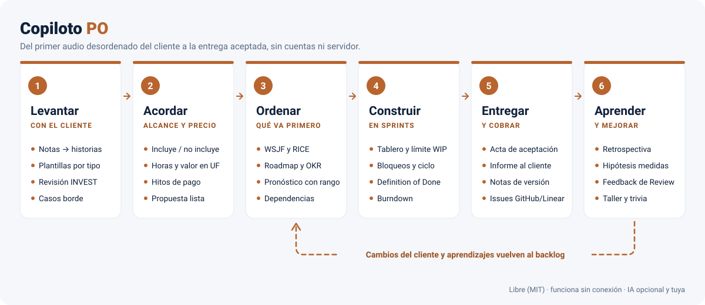
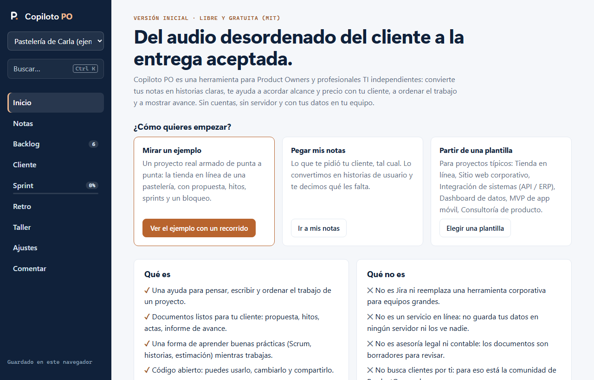
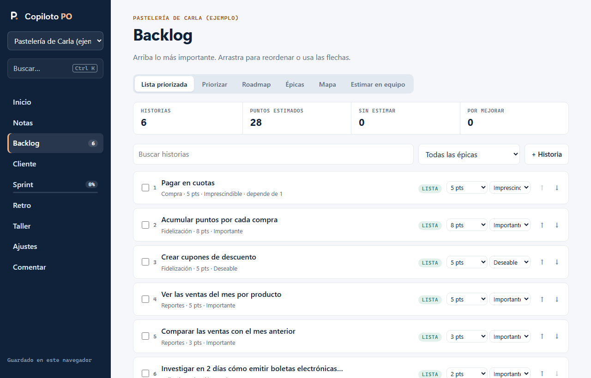
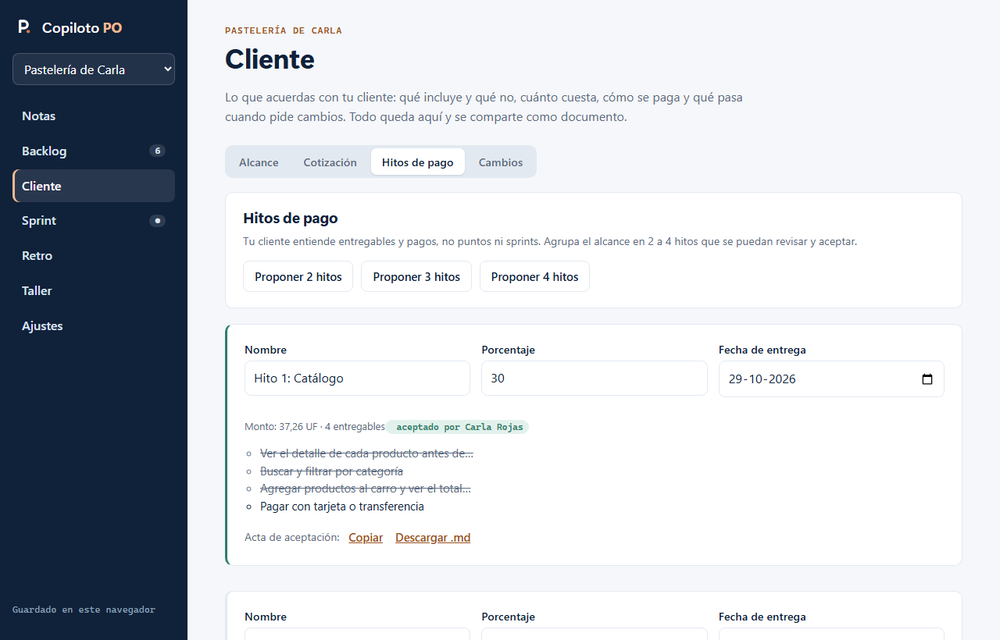
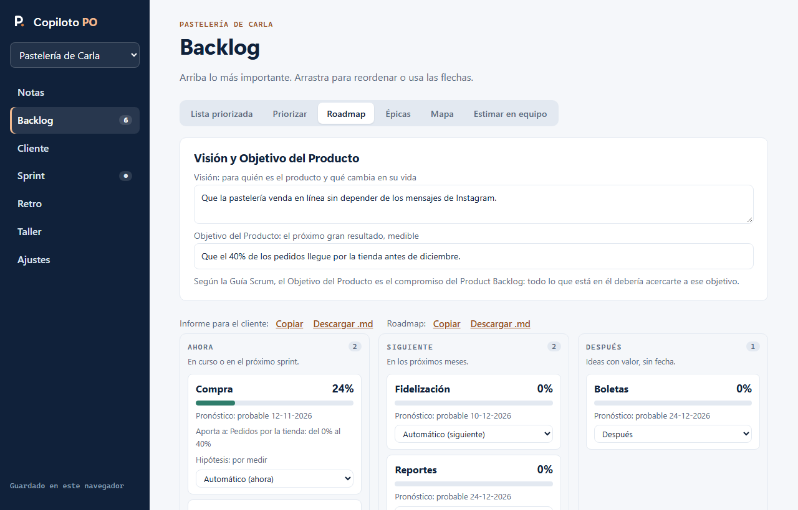
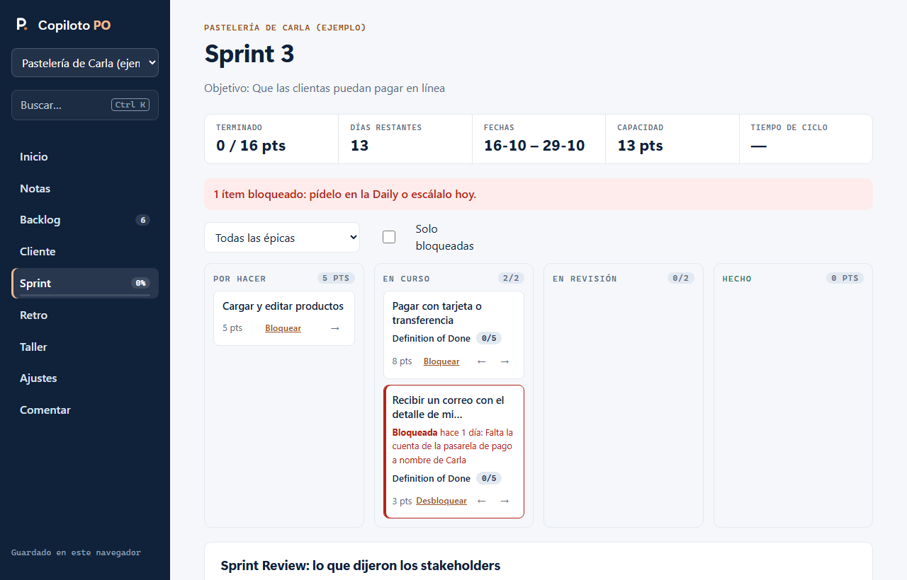

# Copiloto PO

De tus notas a historias de usuario, backlog y sprints. Libre (MIT), sin cuentas, sin servidor y sin conexión.

<picture>
  <source media="(prefers-color-scheme: dark)" srcset="docs/img/flujo-oscuro.svg">
  
</picture>

**[Ábrelo en línea](https://rodrigoatenas001.github.io/productowner-copiloto/)** · **[Descárgalo para usarlo en tu equipo](https://github.com/rodrigoatenas001/productowner-copiloto/releases/latest)**

Pensado para **Product Owners independientes**: una persona que trabaja con uno o varios clientes, a veces con un par de desarrolladores, y que no necesita (ni quiere pagar) una herramienta corporativa como Jira para ordenar el trabajo y mostrar avance. Es parte de la comunidad de [ProductOwner.cl](https://productowner.cl), donde profesionales TI independientes y clientes se encuentran.

> **Versión inicial.** Al abrirlo verás qué es, qué no es y sus límites, un proyecto de ejemplo con un recorrido de 4 pasos y una encuesta corta en **Comentar**. Es libre porque queremos que crezca con lo que aportan quienes lo usan: [deja tu comentario](https://github.com/rodrigoatenas001/productowner-copiloto/issues/new?template=comentario.md) aunque sea para decir que no te calza.



## Qué hace, etapa por etapa

**Visión y rumbo**
- Visión y **Objetivo del Producto** (Guía Scrum 2020), **OKR** y **roadmap Ahora / Siguiente / Después** que se arma solo con lo que está en curso y el pronóstico (y que puedes ajustar a mano).
- **Hipótesis de valor** por épica ("Creemos que al… lograremos… lo sabremos cuando…") y su **resultado medido**: se cumplió, en parte o no.
- **KPIs de producto y adopción**: cada resultado clave tiene unidad, línea base, meta y **mediciones fechadas**, con su avance hacia la meta (sirve si la meta es subir o bajar), la tendencia y un gráfico pequeño. «Agregar KPIs de adopción» propone uso real, tiempo de ciclo y errores: entregar a tiempo no basta si nadie lo usa.

**Del caos al backlog**
- **Mapa del proceso (BPMN liviano)**: el circuito real del cliente en carriles por actor, con inicio, tareas, decisiones y fin. Cada tarea se enlaza con sus historias y la revisión avisa qué falta: decisiones con una sola salida, pasos sueltos, tareas sin historias e historias que no están en ningún paso. Si olvidaste un paso, **«+ Tarea después»** lo inserta en su lugar y lo deja conectado entre el anterior y el siguiente. Los carriles se renombran y reordenan. Se exporta a **BPMN 2.0** (`.bpmn`) para abrirlo en bpmn.io, Camunda Modeler o Bizagi.
- **Plantillas de proceso por industria**: para no partir de una hoja en blanco. Primer lote: **Agroindustria y plantas** (recepción y calidad de materia prima, mermas en la línea, mantenimiento) y **Construcción y obras** (estado de pago, avance diario en terreno, abastecimiento y bodega). Traen actores, camino feliz, decisiones, tiempos sugeridos y **dolores típicos** que confirmas con lo que ves en terreno. Con IA, se adaptan a la empresa (cargos, sistemas) sin cambiar el circuito.
- **Del proceso al backlog**: «Generar historias del flujo» propone una historia por tarea, con el rol del actor, su para qué, un criterio por cada salida de la decisión siguiente y los dolores confirmados como criterios; los cuellos de botella salen como imprescindibles. Funciona sin IA; con IA, mejora la redacción. Se revisan antes de agregarlas y quedan enlazadas a su paso.
- **Flujo de valor (VSM)**: en cada tarea del proceso anotas cuánto se trabaja y cuánto se espera antes («45 min», «2 h», «1,5 d»). Ves el tiempo total del circuito, la eficiencia (trabajo sobre total) y el **cuello de botella** marcado en el diagrama, para no automatizar algo que no era el problema.
- **Notas → historias** "Como… quiero… para…", con reglas o con IA; **importar** desde CSV de Jira o Excel. Sin IA entiende notas escritas como se toman en una reunión: «el mecánico necesita ver la agenda» queda como «Como mecánico, quiero ver la agenda». El encabezado de la reunión se marca como contexto y no se agrega; las preguntas abiertas pasan a spike, y las líneas que describen un problema piden reescribirse como necesidad.
- **Sin falsos «Lista»**: no inventa criterios de aceptación de relleno, y una historia sin criterios reales, una pregunta o un problema nunca aparece como lista.
- Avisa las **historias sin épica** y permite seleccionarlas para asignarles una de una vez.
- **Reglas de negocio** en cada historia (políticas, excepciones y controles), aparte de los criterios de aceptación; viajan en todas las exportaciones.
- **Tipos de ítem** (historia, bug, spike, deuda técnica) y **dependencias** sin ciclos.
- **Feedback de la Sprint Review** que pasa directo al backlog.

**Acordar con el cliente**
- **Plantillas por tipo de proyecto** (tienda en línea, sitio corporativo, integración API/ERP, dashboard, MVP móvil, consultoría) con historias, exclusiones y supuestos típicos.
- **Stakeholders**: matriz poder / interés con la estrategia para cada cuadrante, el rol de cada persona (aprueba, opera en terreno, mantiene el sistema) y el actor del proceso que representa. Avisa si falta quien aprueba, quien opera o quien mantiene, y quién opera con poco interés (riesgo de rechazo).
- **Alcance**: qué incluye, qué NO incluye, supuestos y lo que el cliente debe entregar.
- **Cotización** en UF o pesos: horas por ítem (o por puntos), valor hora y margen de imprevistos.
- **Hitos de pago** con sus entregables y **acta de aceptación** para que el cliente firme y se libere el pago.
- **Solicitudes de cambio** con su impacto en horas, valor y plazo, y una **respuesta lista para enviar**.
- Todo sale como documento, en **Word, PDF o Markdown**: **propuesta**, actas de aceptación y respuestas a cambios. Son borradores; no reemplazan un contrato ni asesoría legal.

**Refinamiento**
- **Revisión INVEST** por tipo, **casos borde** automáticos y **métricas** sugeridas para palabras vagas.
- **Dividir** historias, **mejorar criterios** con IA y **revisión en dos voces** (una IA revisa como QA, otra corrige como PO).
- **Definition of Ready** (avisa «no lista» solo cuando el equipo empieza a usarla) y **planning poker** en una pantalla.
- **Mapa de historias** clásico (Jeff Patton): de izquierda a derecha, el recorrido según los pasos del proceso, con quién hace cada uno arriba; debajo, las historias de cada paso por versión, y la primera fila es lo mínimo para recorrer el circuito completo. Lo que no está en el proceso queda en «Soporte». También se puede ver por épicas. Arrastrar una tarjeta cambia su paso o su versión.

**Priorizar y pronosticar**
- MoSCoW, **WSJF**, **RICE** y **matriz valor/esfuerzo**.
- **"¿Cuándo va a estar?"**: pronóstico por épica y del backlog con rango optimista / probable / pesimista, a partir de la velocidad real.

**Sprint**
- Capacidad, sugerencia automática, **objetivo del sprint** (reglas o IA), tablero, burndown y **Definition of Done**.
- **Kanban liviano** dentro del sprint: columna "En revisión" opcional, **límites de trabajo en curso**, **bloqueos** con motivo y **tiempo de ciclo**.
- **Daily**: para los 15 minutos, lo terminado desde la última Daily, lo que está en curso (y la pregunta «¿sigue avanzando?» pasados 3 días), lo bloqueado y si el sprint va a tiempo; el resumen se copia para el chat del equipo.
- **Kanban continuo**, sin sprints, para soporte e incidencias: se trae trabajo del backlog cuando hay capacidad, con límite por columna, y se mide el flujo (terminadas por semana, tiempo de entrega y de ciclo al percentil 85 y **diagrama de flujo acumulado**). Se activa en Ajustes › Flujo del tablero.
- **Retrospectiva** con votos y acciones que se revisan en la siguiente.

**Comunicar**
- **Documentos con formato**, generados en tu navegador, sin conexión:
  - **Backlog en Excel**: encabezado fijo, filtros, prioridad y estado con color, criterios y reglas, WSJF, sprint y paso del proceso; lista para imprimir.
  - **Proyecto en Excel**: resumen, backlog, épicas con hipótesis, proceso, sprints, hitos de pago y cambios, cada uno en su hoja.
  - **Proyecto en Word y PDF**: portada, alcance, proceso, historias por épica con criterios como casillas y reglas, cotización, hitos, sprints y mejoras de las retrospectivas, con número de página. El Word usa estilos de título reales, así que puedes generar el índice.
- **Informe para el cliente**: resumen sin jerga, entregas, lo que viene con fechas estimadas, resultados y "lo que necesitamos de ti".
- Reporte de sprint, roadmap, avance por épica, retro y **notas de versión** (también redactadas por IA), en Markdown.
- **Especificación para agentes de IA** (Claude Code, Antigravity, Cursor) con fuera de alcance explícito.
- **Issues de GitHub y Linear** en un clic, CSV para Jira con épicas enlazadas y guía de JQL.

**Aprender**
- **Taller**: trivia tipo Kahoot para proyectar, ejercicios de historias con retroalimentación y desafíos de pronóstico, tipos de ítem y validación de hipótesis.

**Siempre**
- **Cómo funciona**: el mapa del flujo en seis etapas (levantar, acordar, ordenar, construir, entregar y aprender), con el estado de tu proyecto en cada una y un atajo a la sección donde se hace.
- **Glosario**: un botón **?** junto a cada término (INVEST, MoSCoW, WSJF, Definition of Ready, BPMN…) con su definición y un ejemplo.
- **Pantallas anchas**: el mapa de historias, el proceso, el roadmap y el tablero usan todo el ancho; los textos quedan a un ancho cómodo de leer.
- **Proyectos grandes**: probado con 250 y 1000 historias. Con 250 todo responde en menos de 100 ms; la lista y Priorizar muestran de a 100 historias («Mostrar 100 más») y la búsqueda recorre todo el backlog.
- Con el ejemplo abierto, **«Crear mi proyecto»** parte tu propio proyecto, para no mezclar tu trabajo con el de Carla.
- Funciona **sin IA**; si quieres, conecta la tuya (Ollama en tu equipo o tu propia clave).
- **Deshacer**, recordatorio de **respaldo** y todo guardado en tu navegador.
- **Usar en varios equipos** (Chrome y Edge de escritorio): elige en Ajustes una carpeta que tu nube sincronice (OneDrive, Google Drive o Dropbox). Cada proyecto queda como un archivo; en el otro equipo eliges la misma carpeta y aparecen todos. Si editaste el mismo proyecto en los dos lados, te pregunta cuál conservar y la otra versión queda en la carpeta `papelera`; los proyectos borrados también van ahí. Si la carpeta se mueve o se borra, avisa y te deja elegirla de nuevo; mientras tanto, los cambios quedan en el navegador.

## Así se ve

Capturas con el proyecto de ejemplo [`docs/ejemplo/pasteleria-carla.json`](docs/ejemplo/pasteleria-carla.json), que puedes abrir desde Inicio → Ver el ejemplo (o importarlo desde Ajustes → Importar respaldo). Es la tienda en línea de una pastelería, levantada de punta a punta: sus stakeholders, el circuito del pedido en tres carriles con su flujo de valor (el cuello de botella es la espera al despacho), historias con criterios «Dado… cuando… entonces…» y reglas de negocio, prioridad MoSCoW y WSJF, cotización en UF, hitos, sprints, una retrospectiva y los resultados clave medidos. Sirve para mostrar el método sin exponer datos de clientes reales.

| | |
|---|---|
|  |  |
| **Backlog** priorizado, con la revisión de calidad de cada historia | **Cliente:** hitos de pago, montos y acta de aceptación |
|  |  |
| **Roadmap** con visión, objetivo y pronóstico por épica | **Sprint** con límites de trabajo en curso y bloqueos |

## Hoja de ruta

Lo que viene depende de quienes lo usen; estas son las ideas evaluadas y su estado.

**Ideas a evaluar más adelante**
- **Trabajo en equipo**: que varias personas editen el mismo proyecto a la vez. Hoy se usa en una pantalla compartida, y la carpeta sincronizada sirve para una persona en varios equipos. Se evaluará si aparece la necesidad, sin agregar servidores ni cuentas.
- **Personas**: un catálogo de roles con sus objetivos y frustraciones, para usarlos en historias y en la IA.

**Decidido no hacer**
- Un servidor propio o cuentas: el valor está en que tus datos son tuyos.
- Envío directo por API a Jira (exige tokens y Jira no lo permite desde el navegador); se usa CSV o el enlace de issue.
- Clasificación Kano automática: Kano se obtiene preguntando a usuarios reales.

¿Tienes una idea? Abre un *issue* en este repositorio o escríbenos en [ProductOwner.cl](https://productowner.cl).

## Con equipos

Está pensado para una persona, o para un equipo **mirando la misma pantalla** (presencial o compartiendo pantalla): planificar, estimar, la retro y la trivia funcionan así. Para usar tus proyectos en varios computadores, elige en Ajustes una carpeta sincronizada por tu nube (Chrome y Edge de escritorio); en otros navegadores, descarga el respaldo e impórtalo en el otro equipo. No está pensado para que dos personas editen el mismo proyecto al mismo tiempo.

## Privacidad

- **Copiloto PO no recopila datos.** No tiene servidor, cuentas, cookies ni analítica: todo lo que escribes se guarda en tu navegador (IndexedDB) y no se envía a nadie. Si eliges una carpeta sincronizada, los archivos van a esa carpeta y de ahí solo a tu propia nube.
- La única excepción es la IA, si tú la conectas: tus notas viajan **solo** al servicio que configuraste y solo cuando usas una función con IA. La clave queda guardada en tu navegador. Con Ollama, nada sale de tu equipo.
- Quien publica la página (GitHub Pages, tu propio GitHub o tu servidor) puede registrar visitas técnicas, como cualquier sitio web, bajo sus propias políticas. Usarlo desde el ZIP en tu equipo evita incluso eso.
- Los datos del navegador se pueden borrar (limpieza, otro equipo, modo privado): usa la carpeta sincronizada o descarga un respaldo desde Ajustes de vez en cuando.

## Usarlo

Hay tres formas; los datos son los mismos en todas: se guardan en el navegador que uses.

### 1. En línea, sin instalar nada

Ábrelo en **https://rodrigoatenas001.github.io/productowner-copiloto/**. En Chrome o Edge, usa **Instalar aplicación** para tenerlo como programa y usarlo sin conexión.

### 2. Descargado en tu equipo

1. Descarga el ZIP de la última versión en [Releases](https://github.com/rodrigoatenas001/productowner-copiloto/releases/latest) y descomprímelo en una carpeta fija (por ejemplo, Documentos).
2. Ábrelo:
   - **Windows:** doble clic en **`Abrir Copiloto PO.bat`**. No necesita instalar nada.
   - **Mac:** doble clic en **`abrir-copiloto.command`**. La primera vez, macOS puede pedir permiso: clic derecho → Abrir → Abrir. Usa Python 3 (si no lo tienes, el lanzador te dice cómo instalarlo).
   - **Linux:** `sh abrir-copiloto.command`.
3. Se abre el navegador en `http://localhost:8765`. Deja la ventana del lanzador abierta mientras lo usas.

Importante: usa siempre el mismo lanzador y no cambies el puerto. El navegador guarda tus proyectos asociados a esa dirección exacta; si cambia, parecerá que desaparecieron (siguen ahí, en la dirección anterior). Para pasar tus proyectos a otra dirección o equipo, usa el respaldo de Ajustes.

¿Por qué no basta con doble clic en `index.html`? Por seguridad, los navegadores no cargan módulos de JavaScript desde archivos sueltos. El lanzador levanta un servidor mínimo, solo para tu equipo.

### 3. Tu propia copia en GitHub

Para tener tu versión en línea, bajo tu control:

1. Inicia sesión en GitHub y presiona **Fork** en este repositorio.
2. En tu copia: **Settings → Pages**.
3. En "Build and deployment", elige **Deploy from a branch**, rama **main** y carpeta **/ (root)**. Guarda.
4. En uno o dos minutos estará en `https://TU-USUARIO.github.io/productowner-copiloto/`.

Para recibir mejoras, en tu copia usa **Sync fork**. Es gratis para repositorios públicos.

### Usar Ollama

```bash
ollama pull llama3.1
OLLAMA_ORIGINS=http://localhost:8765 ollama serve
```

Cambia `OLLAMA_ORIGINS` por la dirección desde donde abres Copiloto PO (por ejemplo, `https://rodrigoatenas001.github.io` si lo usas en línea). En Ajustes → IA elige "Ollama", deja la dirección `http://localhost:11434` y presiona "Probar conexión".

## Desarrollo

Sin dependencias ni paso de compilación: HTML, CSS y módulos de JavaScript.

```
index.html, sw.js, manifest.webmanifest
css/app.css
js/app.js          estado, navegación y guardado
js/almacen.js      IndexedDB
js/ia.js           conexión opcional con IA
js/nucleo/         lógica pura (historias, INVEST, sprints, exportación), probada con node --test
js/ui/             vistas: notas, backlog, sprint, ajustes
tests/
```

```bash
npm test          # lógica (node --test)
npm run test:ui   # interfaz: 20 escenarios en la app real, en Chrome o Edge sin ventana
npm run imagenes  # regenera el diagrama del flujo, el proyecto de ejemplo y las capturas del README
```

Las pruebas de interfaz también se pueden ver en vivo abriendo `tests/ui.html` con el servidor local. Usan una base de datos aparte (`?prueba`), así que no tocan tus proyectos.

Al publicar una versión nueva, cambia `VERSION` en `sw.js` para que los navegadores descarguen los archivos nuevos.

Reglas de la casa: el DOM se construye con nodos (nunca `innerHTML` con datos del usuario), sin estilos en línea, accesible con teclado y lector de pantalla, y todo texto de la interfaz en español claro.

## Licencia

[MIT](LICENSE). Úsalo, cámbialo y compártelo.
