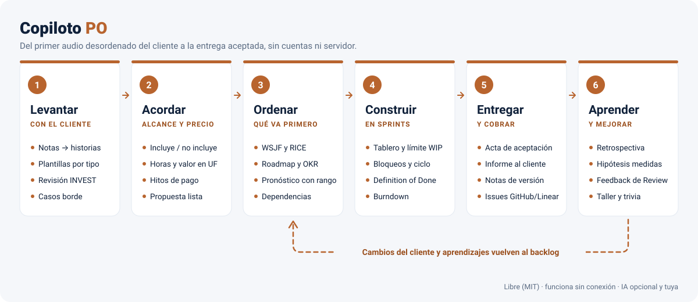
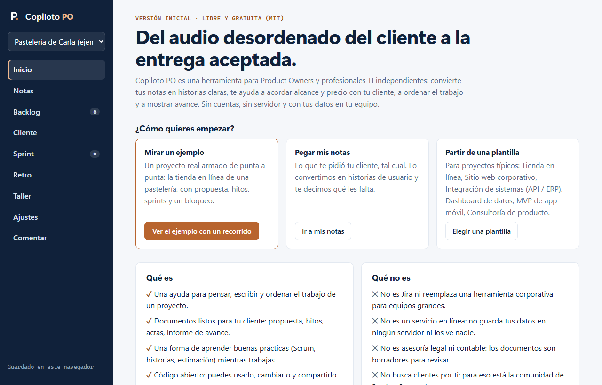
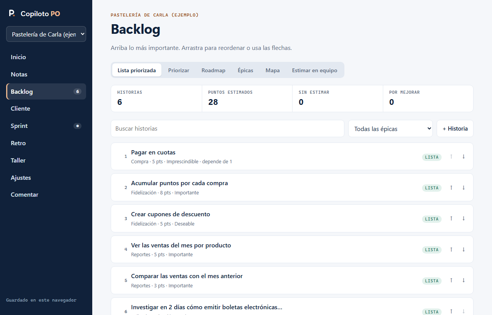
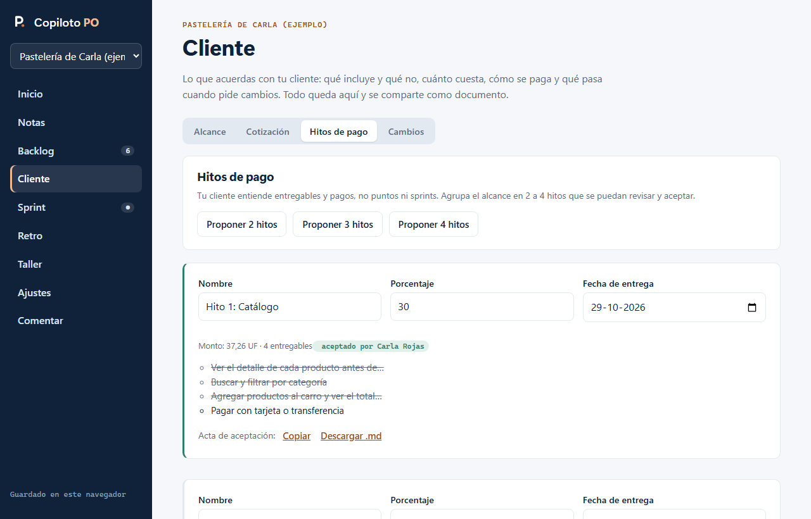
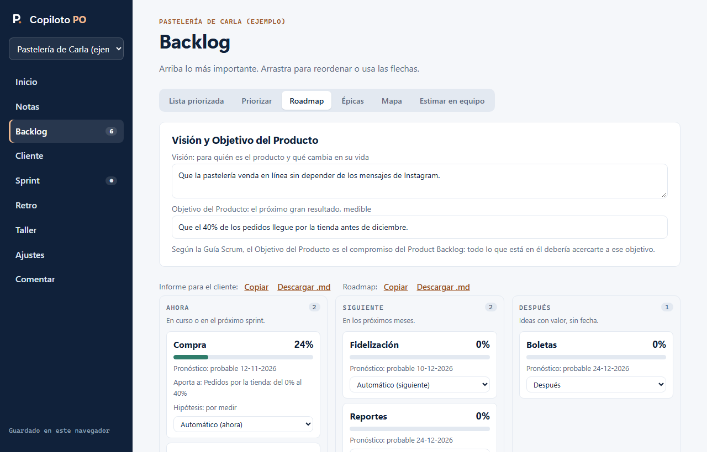
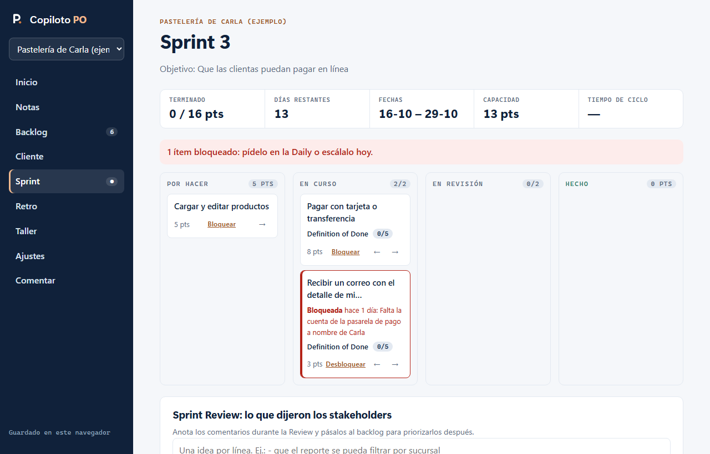

# Copiloto PO

De tus notas a historias de usuario, backlog y sprints. Libre (MIT), sin cuentas, sin servidor y sin conexión.

<picture>
  <source media="(prefers-color-scheme: dark)" srcset="docs/img/flujo-oscuro.svg">
  
</picture>

**[Ábrelo en línea](https://rodrigoatenas001.github.io/productowner-copiloto/)** · **[Descárgalo para usarlo en tu equipo](https://github.com/rodrigoatenas001/productowner-copiloto/releases/latest)**

Pensado para **Product Owners independientes**: una persona que trabaja con uno o varios clientes, a veces con un par de desarrolladores, y que no necesita (ni quiere pagar) una herramienta corporativa como Jira para ordenar el trabajo y mostrar avance. Es parte de la comunidad de [ProductOwner.cl](https://productowner.cl), donde profesionales TI independientes y clientes se encuentran.

> **Versión inicial.** Al abrirlo verás qué es, qué no es y sus límites, un proyecto de ejemplo con un recorrido de 4 pasos y una encuesta corta en **Comentar**. Es libre porque queremos que crezca con lo que aportan quienes lo usan: [deja tu comentario](https://github.com/rodrigoatenas001/productowner-copiloto/issues/new?template=comentario.md) aunque sea para decir que no te calza.



## Qué hace, etapa por etapa

**Visión y rumbo**
- Visión y **Objetivo del Producto** (Guía Scrum 2020), **OKR** y **roadmap Ahora / Siguiente / Después** que se arma solo con lo que está en curso y el pronóstico (y que puedes ajustar a mano).
- **Hipótesis de valor** por épica ("Creemos que al… lograremos… lo sabremos cuando…") y su **resultado medido**: se cumplió, en parte o no.

**Del caos al backlog**
- **Notas → historias** "Como… quiero… para…", con reglas o con IA; **importar** desde CSV de Jira o Excel.
- **Tipos de ítem** (historia, bug, spike, deuda técnica) y **dependencias** sin ciclos.
- **Feedback de la Sprint Review** que pasa directo al backlog.

**Acordar con el cliente**
- **Plantillas por tipo de proyecto** (tienda en línea, sitio corporativo, integración API/ERP, dashboard, MVP móvil, consultoría) con historias, exclusiones y supuestos típicos.
- **Alcance**: qué incluye, qué NO incluye, supuestos y lo que el cliente debe entregar.
- **Cotización** en UF o pesos: horas por ítem (o por puntos), valor hora y margen de imprevistos.
- **Hitos de pago** con sus entregables y **acta de aceptación** para que el cliente firme y se libere el pago.
- **Solicitudes de cambio** con su impacto en horas, valor y plazo, y una **respuesta lista para enviar**.
- Todo sale como documento: **propuesta**, actas y respuestas. Son borradores; no reemplazan un contrato ni asesoría legal.

**Refinamiento**
- **Revisión INVEST** por tipo, **casos borde** automáticos y **métricas** sugeridas para palabras vagas.
- **Dividir** historias, **mejorar criterios** con IA y **revisión en dos voces** (una IA revisa como QA, otra corrige como PO).
- **Definition of Ready**, **mapa de historias** y **planning poker** en una pantalla.

**Priorizar y pronosticar**
- MoSCoW, **WSJF**, **RICE** y **matriz valor/esfuerzo**.
- **"¿Cuándo va a estar?"**: pronóstico por épica y del backlog con rango optimista / probable / pesimista, a partir de la velocidad real.

**Sprint**
- Capacidad, sugerencia automática, **objetivo del sprint** (reglas o IA), tablero, burndown y **Definition of Done**.
- **Kanban liviano**: columna "En revisión" opcional, **límites de trabajo en curso**, **bloqueos** con motivo y **tiempo de ciclo**.
- **Retrospectiva** con votos y acciones que se revisan en la siguiente.

**Comunicar**
- **Informe para el cliente**: resumen sin jerga, entregas, lo que viene con fechas estimadas, resultados y "lo que necesitamos de ti".
- Reporte de sprint, roadmap, avance por épica, retro y **notas de versión** (también redactadas por IA), en Markdown.
- **Especificación para agentes de IA** (Claude Code, Antigravity, Cursor) con fuera de alcance explícito.
- **Issues de GitHub y Linear** en un clic, CSV para Jira con épicas enlazadas y guía de JQL.

**Aprender**
- **Taller**: trivia tipo Kahoot para proyectar, ejercicios de historias con retroalimentación y desafíos de pronóstico, tipos de ítem y validación de hipótesis.

**Siempre**
- Funciona **sin IA**; si quieres, conecta la tuya (Ollama en tu equipo o tu propia clave).
- **Deshacer**, recordatorio de **respaldo** y todo guardado en tu navegador.

## Así se ve

Capturas con el proyecto de ejemplo [`docs/ejemplo/pasteleria-carla.json`](docs/ejemplo/pasteleria-carla.json), que puedes abrir desde Inicio → Ver el ejemplo (o importarlo desde Ajustes → Importar respaldo).

| | |
|---|---|
|  |  |
| **Backlog** priorizado, con la revisión de calidad de cada historia | **Cliente:** hitos de pago, montos y acta de aceptación |
|  |  |
| **Roadmap** con visión, objetivo y pronóstico por épica | **Sprint** con límites de trabajo en curso y bloqueos |

## Hoja de ruta

Lo que viene depende de quienes lo usen; estas son las ideas evaluadas y su estado.

**Ideas a evaluar más adelante**
- **Trabajo en equipo**: combinar respaldos de varias personas, o un proyecto en un archivo compartido (OneDrive o Drive). Hoy se usa en una pantalla compartida. Se evaluará si aparece la necesidad, sin agregar servidores ni cuentas.
- **Modo Kanban completo**, sin sprints, con métricas de flujo y diagrama de flujo acumulado. Hoy la base es Scrum, con lo mejor de Kanban dentro del sprint.
- **Personas**: un catálogo de roles con sus objetivos y frustraciones, para usarlos en historias y en la IA.

**Decidido no hacer**
- Un servidor propio o cuentas: el valor está en que tus datos son tuyos.
- Envío directo por API a Jira (exige tokens y Jira no lo permite desde el navegador); se usa CSV o el enlace de issue.
- Clasificación Kano automática: Kano se obtiene preguntando a usuarios reales.

¿Tienes una idea? Abre un *issue* en este repositorio o escríbenos en [ProductOwner.cl](https://productowner.cl).

## Con equipos

Está pensado para una persona, o para un equipo **mirando la misma pantalla** (presencial o compartiendo pantalla): planificar, estimar, la retro y la trivia funcionan así. No sincroniza entre equipos distintos porque no hay servidor; para pasar un proyecto, se descarga el respaldo y se importa en el otro navegador.

## Privacidad

- **Copiloto PO no recopila datos.** No tiene servidor, cuentas, cookies ni analítica: todo lo que escribes se guarda en tu navegador (IndexedDB) y no se envía a nadie.
- La única excepción es la IA, si tú la conectas: tus notas viajan **solo** al servicio que configuraste y solo cuando usas una función con IA. La clave queda guardada en tu navegador. Con Ollama, nada sale de tu equipo.
- Quien publica la página (GitHub Pages, tu propio GitHub o tu servidor) puede registrar visitas técnicas, como cualquier sitio web, bajo sus propias políticas. Usarlo desde el ZIP en tu equipo evita incluso eso.
- Los datos del navegador se pueden borrar (limpieza, otro equipo, modo privado): descarga un respaldo desde Ajustes de vez en cuando.

## Usarlo

Hay tres formas; los datos son los mismos en todas: se guardan en el navegador que uses.

### 1. En línea, sin instalar nada

Ábrelo en **https://rodrigoatenas001.github.io/productowner-copiloto/**. En Chrome o Edge, usa **Instalar aplicación** para tenerlo como programa y usarlo sin conexión.

### 2. Descargado en tu equipo

1. Descarga el ZIP de la última versión en [Releases](https://github.com/rodrigoatenas001/productowner-copiloto/releases/latest) y descomprímelo en una carpeta fija (por ejemplo, Documentos).
2. Ábrelo:
   - **Windows:** doble clic en **`Abrir Copiloto PO.bat`**. No necesita instalar nada.
   - **Mac:** doble clic en **`abrir-copiloto.command`**. La primera vez, macOS puede pedir permiso: clic derecho → Abrir → Abrir. Usa Python 3 (si no lo tienes, el lanzador te dice cómo instalarlo).
   - **Linux:** `sh abrir-copiloto.command`.
3. Se abre el navegador en `http://localhost:8765`. Deja la ventana del lanzador abierta mientras lo usas.

Importante: usa siempre el mismo lanzador y no cambies el puerto. El navegador guarda tus proyectos asociados a esa dirección exacta; si cambia, parecerá que desaparecieron (siguen ahí, en la dirección anterior). Para pasar tus proyectos a otra dirección o equipo, usa el respaldo de Ajustes.

¿Por qué no basta con doble clic en `index.html`? Por seguridad, los navegadores no cargan módulos de JavaScript desde archivos sueltos. El lanzador levanta un servidor mínimo, solo para tu equipo.

### 3. Tu propia copia en GitHub

Para tener tu versión en línea, bajo tu control:

1. Inicia sesión en GitHub y presiona **Fork** en este repositorio.
2. En tu copia: **Settings → Pages**.
3. En "Build and deployment", elige **Deploy from a branch**, rama **main** y carpeta **/ (root)**. Guarda.
4. En uno o dos minutos estará en `https://TU-USUARIO.github.io/productowner-copiloto/`.

Para recibir mejoras, en tu copia usa **Sync fork**. Es gratis para repositorios públicos.

### Usar Ollama

```bash
ollama pull llama3.1
OLLAMA_ORIGINS=http://localhost:8765 ollama serve
```

Cambia `OLLAMA_ORIGINS` por la dirección desde donde abres Copiloto PO (por ejemplo, `https://rodrigoatenas001.github.io` si lo usas en línea). En Ajustes → IA elige "Ollama", deja la dirección `http://localhost:11434` y presiona "Probar conexión".

## Desarrollo

Sin dependencias ni paso de compilación: HTML, CSS y módulos de JavaScript.

```
index.html, sw.js, manifest.webmanifest
css/app.css
js/app.js          estado, navegación y guardado
js/almacen.js      IndexedDB
js/ia.js           conexión opcional con IA
js/nucleo/         lógica pura (historias, INVEST, sprints, exportación), probada con node --test
js/ui/             vistas: notas, backlog, sprint, ajustes
tests/
```

```bash
npm test          # lógica (node --test)
npm run test:ui   # interfaz: 20 escenarios en la app real, en Chrome o Edge sin ventana
npm run imagenes  # regenera el diagrama del flujo, el proyecto de ejemplo y las capturas del README
```

Las pruebas de interfaz también se pueden ver en vivo abriendo `tests/ui.html` con el servidor local. Usan una base de datos aparte (`?prueba`), así que no tocan tus proyectos.

Al publicar una versión nueva, cambia `VERSION` en `sw.js` para que los navegadores descarguen los archivos nuevos.

Reglas de la casa: el DOM se construye con nodos (nunca `innerHTML` con datos del usuario), sin estilos en línea, accesible con teclado y lector de pantalla, y todo texto de la interfaz en español claro.

## Licencia

[MIT](LICENSE). Úsalo, cámbialo y compártelo.
